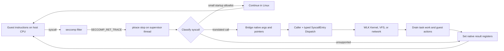

# WLK Native Runner

`wlk-native` is an experimental Linux x86_64 runner. It executes Linux ELF instructions on the host CPU while routing a selected set of Linux syscalls through WLK's kernel, VFS, and network stack. It is an MVP compatibility layer, not a general Linux environment or a hardened sandbox.

See [TODO.md](TODO.md) for known limitations and follow-up work.

## Contents

- [Compatibility and security boundary](#compatibility-and-security-boundary)
- [Quick start](#quick-start)
- [How a process starts](#how-a-process-starts)
- [How a syscall is handled](#how-a-syscall-is-handled)
- [Address-space and pointer bridge](#address-space-and-pointer-bridge)
- [Threads, processes, and task cleanup](#threads-processes-and-task-cleanup)
- [Dynamic ELF loading and exec](#dynamic-elf-loading-and-exec)
- [Memory mappings](#memory-mappings)
- [Which side handles a syscall](#which-side-handles-a-syscall)
- [Filesystem, descriptors, and volumes](#filesystem-descriptors-and-volumes)
- [Networking](#networking)
- [Terminal and signals](#terminal-and-signals)
- [Testing](#testing)
- [Troubleshooting](#troubleshooting)
- [Source map](#source-map)

## Compatibility and security boundary

### Host requirements

- Linux x86_64 host and 64-bit little-endian x86_64 ELF programs.
- ELF `ET_EXEC` and `ET_DYN` images are accepted when their headers and segments pass bounded validation.
- Linux seccomp, ptrace, `process_vm_readv`/`process_vm_writev`, and a usable `/proc/<supervisor-pid>/fd` path are required.
- The runner is designed to run as an ordinary user. It does not require root, cgroups, or namespaces. The child uses `PTRACE_TRACEME`, sets `no_new_privs`, then installs its seccomp filter before `execve`.
- Ptrace uses `PTRACE_O_EXITKILL`; if the supervisor exits unexpectedly, Linux kills the tracees rather than leaving them running without mediation.
- A C compiler is needed for the raw integration fixtures. Static musl and optional shell/dynamic fixture tiers need the toolchains described in [Testing](#testing).

The seccomp filter checks `seccomp_data.arch` first. A syscall from a non-x86_64 ABI kills the tracee; an x32 syscall number returns `ENOSYS`. Other syscall entries return `SECCOMP_RET_TRACE`, causing the ptrace supervisor to decide whether to execute a narrow native startup operation, translate the call into WLK, or return `ENOSYS`.

### What is and is not isolated

This runner does not create a separate host namespace or change the calling user's host identity. With the default `--root /`, WLK's host-backed VFS exposes the host filesystem subject to the permissions of the user running `wlk-native`. `--root DIR` selects the host directory used as the WLK filesystem root; it is a VFS view, not `chroot(2)` or a mount namespace. Volumes expose additional host directories. The network backend uses host sockets.

The syscall filter and WLK routing are useful for exercising WLK's syscall implementations. They do not make this an appropriate security boundary for untrusted programs. In particular, native memory, TLS, and signal setup are still performed by Linux, the process runs with the caller's UID, and the configured filesystem and network are intentionally host-backed. Use only with programs you trust and with host paths you intend to expose.

The implementation supports the tested subset described below. An unrecognized or unsupported syscall normally returns `ENOSYS`; this is not a complete Linux syscall implementation. Some libc runtime calls bypass WLK through the explicit native allowlist, and vDSO calls such as clock reads can run without a syscall stop.

## Quick start

```sh
cargo run -p wlk-native -- [--trace] [--root DIR] [--volume HOST:GUEST[:ro]]... PROGRAM [ARGS...]
```

Runner options must precede `PROGRAM`; everything after it is passed to the guest. `PROGRAM` names a host ELF file, including when a dynamic program must also be reachable through the guest filesystem.

| Option | Meaning |
| --- | --- |
| `--trace` | Print adapter syscall diagnostics to stderr. |
| `--root DIR` | Use the host directory as the WLK filesystem root; defaults to `/`. |
| `--volume HOST:GUEST[:ro]` | Mount a host directory at an absolute guest path; repeat for multiple volumes. |
| `--help` | Print the CLI usage. |

The runner returns the root guest process's exit code, or `128 + signal` for a native signal termination.

For example, an initial static binary may be launched directly from an absolute host path:

```sh
cargo run -p wlk-native -- --trace /path/to/busybox echo hello
```

The initial static image is executed by the host before its later syscalls are mediated. It does not need to be located under the guest `--root` or a volume. Dynamic initial images follow a different path and must be visible through WLK; see [Dynamic ELF loading and exec](#dynamic-elf-loading-and-exec).

### Root and volume example

`--volume HOST:GUEST` adds a writable host directory at an absolute guest path. Append `:ro` to mount it read-only. Missing guest mountpoint directories are created in the selected WLK root, so the host user must have permission to create them.

```sh
mkdir -p /tmp/wlk-native-root /tmp/wlk-native-data
printf 'hello from the host volume\n' > /tmp/wlk-native-data/example.txt

cargo run -p wlk-native -- \
  --root /tmp/wlk-native-root \
  --volume /tmp/wlk-native-data:/data:ro \
  "$PWD/crates/native/tests/fixtures/busybox" ls -l /data

cargo run -p wlk-native -- \
  --root /tmp/wlk-native-root \
  --volume /tmp/wlk-native-data:/data:ro \
  "$PWD/crates/native/tests/fixtures/busybox" cat /data/example.txt
```

The shell commands above assume the optional BusyBox fixture has been downloaded. The runner inherits the host environment and standard input/output/error. It starts the guest working directory at the host current directory when that directory is inside the selected root; otherwise it starts at guest `/`.

### Download optional static Bash and BusyBox

```sh
crates/native/tests/fixtures/download-fixtures.sh
```

The script requires Nix and `sha256sum`. It uses `nix copy` to fetch pinned static x86_64 musl binaries from the signed `cache.nixos.org` binary cache; it does not evaluate a package set or build packages locally. It checks the pinned NAR and executable SHA256 values before atomically installing the ignored `bash` and `busybox` files. Pass an output directory as the first argument to install them elsewhere. The existing [`build-bash.sh`](tests/fixtures/build-bash.sh) and [`build-busybox.sh`](tests/fixtures/build-busybox.sh) scripts remain available for local Nix builds. See the [fixture README](tests/fixtures/README.md) for the pins and fixture details.

## How a process starts

WLK creates the process model before the guest ELF begins execution. The CLI arguments and inherited environment are copied into `ProcessConfig`, a WLK root task is created, and its standard streams are attached to the host process's stdin, stdout, and stderr.

For an initial static program, the native child is forked and stopped before the Tokio runtime is created. Dynamic preparation needs the WLK filesystem first, so its child is forked after runtime startup. The latter child path uses prebuilt buffers and syscall-level setup before `execve`, without Rust allocation or locks after fork.

Static and dynamic initial programs then use different launch paths:

| Image | Initial launch path | Filesystem identity |
| --- | --- | --- |
| Static | The host child calls `execve` on the supplied program path. The child is already traced and filtered. | The executable itself may be anywhere on the host. Its later file syscalls use the WLK root and volumes. |
| Dynamic | The runner maps the host program path to a guest path, asks WLK to load that path, reads the program's `PT_INTERP` through WLK, stages the loader, then starts the loader with the guest program path as its operand. | Program, interpreter, and shared libraries must be visible in the selected WLK root or a mounted volume. |

For a dynamic initial program, the host path must lie under the canonicalized `--root` or one of the `--volume` host directories. The runner preserves the guest-visible main-program path as the loader operand so `$ORIGIN` runpaths are evaluated relative to the program. For recognized glibc and musl loader names it also uses `--argv0` to preserve the guest's original `argv[0]`. Canonicalizing the host path means symlink spelling is not preserved.

## How a syscall is handled

The runner combines two execution models:



At a traced syscall entry the supervisor reads the x86_64 register state: syscall number from `orig_rax` and the six Linux syscall arguments from the x86_64 argument registers. The syscall number and arguments are not dispatched to the host kernel by default.

For a WLK-routed call, the adapter:

1. Finds the WLK task associated with the stopped native TID.
2. Translates the Linux number, scalar values, and pointed-to data into a typed `wasixv2_syscalls::Syscall` and WLK-compatible pointers.
3. Constructs a `Caller` and invokes `SyscallEntry(Dispatch).call(...)` against the WLK `Kernel`.
4. Runs WLK task work and collects pending `GuestAction`s such as child creation, exec handoff, or exit cleanup.
5. Writes the result into the tracee's registers and resumes it.

Successful WLK results use the Linux raw syscall ABI. Errors become negative errno values. To skip the original host syscall, the ptrace adapter sets `orig_rax` to `-1` and places the result in `rax` before continuing. If no translation exists, the runner returns `-ENOSYS` rather than invoking an unknown host syscall.

This goes through the existing typed WLK `Dispatch` entry, preserving the kernel syscall path and its checks. The native layer is an ABI translator and process supervisor; it is not a second filesystem or syscall implementation.

### Native passthrough allowlist

Some syscalls required by Linux process startup and libc continue natively. The current allowlist includes anonymous `mmap`, `mprotect`, `munmap`, `brk`, `madvise`, restricted `mremap`, runtime signal setup/return and `sigaltstack`, `rseq`, selected `arch_prctl` FS/GS operations, and a restricted `prlimit64` query. The exact argument predicates live in [`main.rs`](src/main.rs).

The allowlist is intentionally narrow and is separate from the set translated to WLK. It does not mean all memory, signal, or process syscalls are passed through. Other unknown calls receive `ENOSYS`.

`--trace` prints adapter diagnostics for WLK typed calls and unsupported-syscall fallbacks. It is not a complete `strace`: native-allowlisted calls, vDSO operations, and some internal helper dispatches may not appear.

## Address-space and pointer bridge

The native process uses 64-bit pointers. WLK syscall ABI structures and `UserMemory` use 32-bit guest addresses. [`BridgeMemory`](src/main.rs) and [`AliasRegistry`](src/memory.rs) bridge the two without allocating a 4 GiB byte-for-byte copy of the native address space.

Each WLK call gets a bounded `BridgeMemory` view containing regions for the native buffers that call may read or write. For remote regions, `UserMemory::read` and `UserMemory::write` use `process_vm_readv` and `process_vm_writev` against the stopped tracee. Local argument or scratch data can be placed in a bounded local region. Direction flags enforce whether WLK may read or write each mapped region.

The adapter uses two kinds of address mapping:

- **Transient regions** map buffers for one syscall, including strings, I/O buffers, socket addresses, and ABI structs.
- **Stable aliases** map native addresses that WLK may retain across calls, such as thread TID and futex words. The registry keys aliases by native address-space ID. Forked processes inherit aliases for their copy-on-write address space; exec clears the old image's aliases.

Native structs that differ from WLK's ABI are converted explicitly where implemented. Examples include native x86_64 `iovec` to 32-bit WLK iovecs, WLK `statx` results to native `struct stat`, native wait status, selected socket address layouts, and selected ioctl payloads. Transfers and structures are bounded; Linux partial-copy behavior is not reproduced for every invalid or cross-page buffer.

## Threads, processes, and task cleanup

Linux ptrace relationships belong to an OS thread. The supervisor therefore runs on the same thread that created the tracee and established `PTRACE_TRACEME`. A Tokio `LocalSet` drives WLK syscall futures there; `JoinSet::spawn_local` keeps pending WLK calls associated with their native task without moving ptrace work to a worker thread.

The event loop polls `waitpid` with `__WALL | WNOHANG`, handles a ptrace event or completed WLK call, then yields for 1 ms when idle. A blocked WLK operation can remain pending while the loop services other stopped native tasks.

The scheduler keeps separate identities:

- **Native TID/PID:** Linux thread/process IDs used for ptrace, registers, and `process_vm_*`.
- **WLK `TaskId`:** internal task identity used by WLK calls and lifecycle actions.
- **Virtual Linux PID/TID:** the IDs returned to the guest by WLK process/thread operations.
- **Address-space ID:** shared by native threads in one process and used to scope stable pointer aliases.

For `clone` and thread creation, the adapter first asks WLK to create a thread or child process and records an approval. It then permits the matching native Linux clone event, associates the new native TID with the approved WLK task, and replaces the parent's native clone result with the virtual child ID. Where needed, the adapter writes virtual TIDs through the guest's requested TID pointers. Ordinary pthread create/join and fork/wait behavior have integration fixtures.

Native pthread-style `clone(CLONE_THREAD, ...)` translates to WLK `ThreadSpawn` and its `StartThread` action. Ordinary fork translates to WLK `Clone` and its `Fork` action. Linux supplies the actual child stack, native TLS, and address-space duplication; WLK approves the creation and supplies the virtual task identity. Failed native creation aborts the corresponding WLK child.

`set_tid_address` and the supported non-PI futex operations use WLK task and memory state. During task teardown, WLK `exit_mm` performs clear-TID cleanup while the native address space is still accessible. Futex PI operations and robust-list translation are outside the supported subset. Native vDSO clock reads use the host clock domain; timed monotonic `FUTEX_WAIT_BITSET` is rejected because absolute deadlines are not normalized to WLK's elapsed-time clock.

There is a host-parent workaround for process creation: native `fork` is run as `clone(CLONE_PARENT | SIGCHLD)`, and process-style native clones gain `CLONE_PARENT`. This makes the supervisor the real host parent so it can reap tracees. WLK retains the guest-visible parent/child relationship and owns virtual `wait4` status. Host `/proc` parentage consequently differs from the guest's view.

Supported process creation is deliberately narrow. `vfork`, `clone3`, unusual clone flag combinations, process clones sharing `CLONE_VM`, and process clones with custom child stacks are not supported. `execve`/`execveat` from a multithreaded address space returns `ENOSYS` before WLK commits the new image. Basic wait status is translated from WLK; non-null native `rusage` is unsupported.

On exit, the supervisor uses the native exit stop while the tracee address space is still accessible. It synthesizes a WLK exit when needed, drains exit actions, runs `exit_mm`, releases the WLK task once, and then continues native teardown. This keeps WLK task and memory lifetimes tied to native ptrace events.

## Dynamic ELF loading and exec

The ELF validator in [`elf.rs`](src/elf.rs) accepts bounded ELF64 little-endian x86_64 `ET_EXEC` and `ET_DYN` images with valid load segments and at most one well-formed `PT_INTERP`. WLK's [`NativeBinfmt`](src/exec.rs) uses the same checks when WLK loads a guest image.

For an initial dynamic launch, the runner:

1. Resolves the CLI host path to a guest path under `--root` or `--volume`.
2. Calls WLK `Kernel::exec` for the main program, so WLK resolves and validates the program image.
3. Reads the absolute interpreter path from the image's `PT_INTERP` segment, then opens and reads that path through WLK `Openat` and `Pread64` calls.
4. Stages the loader bytes in a supervisor-owned executable memfd and invokes that loader in the native tracee.
5. Passes the original guest program path to the loader. The loader performs relocations and opens dependencies such as `DT_NEEDED` libraries through intercepted WLK filesystem operations.

The guest root does not need to contain `/proc`; the memfd handoff uses the supervisor's `/proc/<pid>/fd` path. The host must expose procfs at that path. The main program, its `PT_INTERP`, shared libraries, and `$ORIGIN`-relative DSOs must be visible in the WLK filesystem view. A missing interpreter fails during WLK image preparation; missing dependencies produce loader errors. An interpreter that itself declares another `PT_INTERP` is rejected, preventing a second host-side interpreter lookup. A dynamic CLI program outside the selected root and volumes is rejected before launch.

Guest `execve` and supported `execveat` calls also go through WLK. After WLK commits the new image, the runner stages the validated bytes and hands them to Linux. Static exec uses the staged program; dynamic exec stages the guest-resolved loader and preserves the exec path and arguments for the loader. A host-side exec failure after WLK has committed terminates the native task so stale code is not resumed.

This is not byte-for-byte Linux exec identity. With explicit loader invocation, `AT_EXECFN` and `/proc/self/exe` identify the loader memfd rather than the main program, even though WLK retains the main guest image identity. The loader reopens the guest main pathname, so an external host write can race the WLK image snapshot. Empty-path `execveat` and dynamic executables named relative to a custom directory descriptor are rejected before commit. Full Linux multithreaded `de_thread` behavior is not implemented.

## Memory mappings

Anonymous mappings, heap setup, protection changes, and unmapping used by native startup run in Linux under the restricted native allowlist. The memory-management model and accounting are not fully represented in WLK.

For a regular-file `MAP_PRIVATE` mapping, [`mapping.rs`](src/mapping.rs) snapshots bytes through the WLK descriptor using typed `Statx`, `Fcntl64`, and `Pread64` calls. It then injects native anonymous `mmap`/`mprotect` operations into the stopped tracee and copies the bytes into its address space. The mapping is private after creation, and closing or reusing the WLK descriptor does not change its snapshot.

This has important differences from Linux file mappings:

- Later writes to the backing file are not visible in an existing mapping.
- Access beyond file EOF remains zero-filled rather than raising Linux `SIGBUS` after truncation.
- File-backed `MAP_SHARED` is unsupported and returns `ENOSYS`.
- Some less common mmap flags and fixed mappings that would cover the injected syscall site are rejected.
- Native mappings and TLS are outside WLK's full memory accounting.

The synchronous per-TID injection helper in [`injection.rs`](src/injection.rs) uses ptrace syscall stops to run the native mapping operations and `process_vm_*` to copy page contents. This helper exists so file lookup and data reads still go through WLK while the process receives native pages the Linux loader can use.

It saves the registers, validates the syscall instruction at `RIP - 2`, suppresses the original syscall, and consumes the injected calls' ptrace stops with `waitpid` for that TID. No async yield occurs while an injected syscall is running, so the outer event loop cannot consume its stops. WLK file reads may yield between injections while that tracee remains stopped. The original register context is restored before the mmap result is returned. Unexpected signal stops during injection currently fail the run rather than executing a handler in the temporary context.

## Which side handles a syscall

The following table describes the current boundary. It is a guide to the tested adapter, not a complete Linux syscall list.

| Operation | Handling |
| --- | --- |
| Native ELF instructions | Executed by the host CPU in the tracee process. |
| Syscall interception | Linux seccomp `RET_TRACE` plus ptrace on every syscall entry, except rejected ABI cases. |
| Selected libc startup: anonymous memory, `brk`, protections, TLS, signal return/setup, `rseq`, selected FS/GS `arch_prctl` | Passed to Linux only when the native allowlist accepts the syscall and arguments. |
| File open/read/write/seek/stat/directory operations | Translated into WLK filesystem syscalls and WLK descriptors. |
| Process and thread identity, supported clone/fork/exec/wait, futex subset | WLK task/process calls plus native lifecycle events supervised by ptrace. |
| Socket operations in the adapter | Translated into WLK virtual network calls backed by host TCP/UDP sockets. |
| File-backed private `mmap` | File bytes read from WLK, then copied into a private native mapping. |
| Unsupported or unrecognized call | `-ENOSYS`; it is not sent through as an arbitrary host syscall. |
| vDSO entry points | May execute natively without a seccomp syscall stop. |

`poll`, `select`, `epoll`, `sendmsg`/`recvmsg`, and the `mmsg` family do not have native adapters. Basic TCP/UDP socket operations passing tests do not imply general readiness API or server compatibility. Signal disposition and delivery are also not fully bridged: some startup signal syscalls pass natively, and the supervisor suppresses native `SIGCHLD` because WLK owns wait status.

## Filesystem, descriptors, and volumes

The WLK VFS owns guest descriptor semantics. The native adapter translates the common file operations used by the fixtures and shell utilities, including `openat`, `read`, `pread64`, `write`, `readv`, `writev`, `lseek`, `close`, stat-family calls, directory listing, `mkdir`, `rmdir`, `rename`, `unlink`, symlink/readlink, access checks, timestamps, and permissions.

Native x86_64 `struct stat` results are built by translating WLK `Statx` output. The adapter also routes `dup`, `dup2`, `dup3`, the supported scalar `fcntl` commands, and `pipe`/`pipe2` through WLK descriptors. Redirections, duplicated descriptor offsets, and basic pipelines have been exercised with the optional static Bash fixture.

### Root and volume behavior

- Default guest root is host `/`; `--root DIR` selects a host-backed WLK root.
- `--volume HOST:GUEST` mounts a host directory writable at an absolute guest path.
- `--volume HOST:GUEST:ro` marks both the host filesystem view and mount read-only.
- Repeated `--volume` options are accepted. A volume guest target is mounted with parent creation enabled; creating a missing target still requires host permission to write the selected root directory.
- Initial static program lookup is a host `execve` and is intentionally independent of the guest root. Dynamic initial launch requires the program path to map into the guest view.
- The current working directory is inherited only when it is within the selected root; otherwise it becomes `/`.
- Host file permission checks remain in effect because the host-backed VFS runs with the caller's UID.

Read-only volumes deny guest mutation through WLK. They are a VFS policy, not a host mount namespace or an OS-level read-only bind mount.

## Networking

The runner creates a WLK network stack backed by a host socket backend. The adapter translates selected Linux socket operations including `socket`, `connect`, `bind`, `listen`, `accept`/`accept4`, `sendto`, `recvfrom`, `shutdown`, socket names, socket options, and `socketpair`.

Networking conventions:

- A guest client reaches a host-loopback service at `10.0.2.2`.
- A guest listener bound to wildcard or a non-loopback guest address is published on host `127.0.0.1` at the same port.
- A listener bound only to guest `127.0.0.1` remains private to the guest network.
- Host networking and name resolution are not isolated from the user running the runner.

The current adapter does not translate `poll`, `select`, `epoll`, `sendmsg`, `recvmsg`, or multi-message socket calls. Applications requiring those APIs may receive `ENOSYS` even if their basic connect/send/receive path is supported.

## Terminal and signals

Standard input, output, and error are attached as WLK stream descriptors. A small set of terminal ioctl payloads is translated. Unsupported ioctls on a valid stream descriptor return `ENOTTY`; a closed descriptor returns `EBADF`.

An interactive static Bash can show a prompt with `-i`, but WLK Native does not currently provide a controlling terminal or full job control. Bash may report that it cannot set the terminal process group and that job control is unavailable. `+m` does not suppress Bash's startup job-control initialization. `fg`/`bg`, Ctrl-Z, Ctrl-C signal integration, and Readline terminal editing are unavailable or unverified.

The native process group/session calls are routed to WLK virtual IDs. Do not assume those virtual IDs correspond to host process groups. In particular, native `TIOCSPGRP` is not forwarded using a virtual group ID. WLK signal actions and native signal delivery remain only partially integrated.

## Testing

The integration suite is Linux-only. The raw fixture builder compiles small freestanding x86_64 ELF programs with `CC` (default `gcc`); the fixture outputs are ignored. Tests use bounded timeouts and kill the tracee process group on hangs.

Run the baseline native smoke suite:

```sh
cargo test -p wlk-native --test smoke --locked
```

The baseline covers raw argv/exit handling, virtual `getpid`, filesystem I/O, invalid pointers, unsupported syscalls, process groups and ioctl errors, descriptor duplication and offsets, and private/shared mapping behavior. It also exercises freestanding ELF and syscall paths without a libc toolchain.

The complete suite, including the separate incoming-network listener test, is:

```sh
cargo test -p wlk-native --locked
```

### Static libc and process fixtures

To build and run the normal static musl libc probe, provide an x86_64 musl compiler. With nixpkgs:

```sh
nix --extra-experimental-features 'nix-command flakes' shell \
  'nixpkgs#pkgsCross.musl64.stdenv.cc' -c env \
  CC=x86_64-unknown-linux-musl-gcc \
  MUSL_CC=x86_64-unknown-linux-musl-gcc \
  cargo test -p wlk-native --test smoke --locked
```

When `MUSL_CC` is available, this adds a libc-backed static program, pthread create/join, fork/wait with inherited file offsets, static and dynamic exec, filesystem lifecycle, read-only volume, and TCP/UDP loopback tests. Without the compiler, those cases are skipped rather than built from source by the test suite. The libc-backed fork/exec fixtures are built by `build.sh` when a static musl compiler is available.

The optional downloaded Bash and BusyBox binaries enable further acceptance cases:

```sh
crates/native/tests/fixtures/download-fixtures.sh
cargo test -p wlk-native --test smoke --locked
```

BusyBox checks include `echo`, `cat`, `ls`, `mkdir`, `touch`, `rm`, and `rmdir`. Bash checks include `>`, `>>`, `<`, `2>&1`, stdout restoration after a builtin, duplicated descriptor offsets, pipelines, and command substitution. See [fixtures/README.md](tests/fixtures/README.md).

### Dynamic glibc and musl matrix

The dynamic fixture builder creates the main program, a transitive `$ORIGIN` DSO chain, and a `dlopen` plugin. It exercises constructors, `dlopen`/`dlsym`/`dlclose`, pthread TLS, guest roots and volumes, missing dependencies, and hidden interpreters. The full musl-enabled suite also checks a static guest and a forked static guest executing dynamic glibc images.

The host `gcc` builds glibc fixtures. `MUSL_CC` enables the separate musl variant. To run the dynamic tests with both toolchains:

```sh
nix --extra-experimental-features 'nix-command flakes' shell \
  'nixpkgs#pkgsCross.musl64.stdenv.cc' -c env \
  CC=x86_64-unknown-linux-musl-gcc \
  MUSL_CC=x86_64-unknown-linux-musl-gcc \
  cargo test -p wlk-native --test smoke --locked dynamic_ -- --nocapture
```

To build the glibc fixture and run it with the default WLK root:

```sh
crates/native/tests/fixtures/build-dynamic.sh
cargo run -p wlk-native -- --trace \
  "$PWD/crates/native/tests/fixtures/dynamic-libs/glibc/bin/dynamic_smoke"
```

For a dynamic program under an isolated root or volume, use the corresponding integration tests; they stage the interpreter and runtime libraries at their guest-visible paths. The dynamic fixtures and generated ELF files are ignored.

### Manual Bash process probe

After downloading static Bash and BusyBox, this command checks a builtin, a subshell, a background child with `wait`, and a static external BusyBox command:

```sh
bash_bin="$PWD/crates/native/tests/fixtures/bash"
busybox_bin="$PWD/crates/native/tests/fixtures/busybox"
cargo run -p wlk-native -- --trace "$bash_bin" --noprofile --norc -c '
printf "bash builtin\n"
(printf "subshell pid=%s\n" "$BASHPID")
(printf "child pid=%s\n" "$BASHPID") & child=$!
wait "$child"
printf "before external command\n"
"$1" echo "external BusyBox"
printf "after external command\n"
' bash "$busybox_bin"
```

For a prompt attached to a PTY, force interactive mode:

```sh
cargo run -p wlk-native -- "$PWD/crates/native/tests/fixtures/bash" --noprofile --norc -i
```

Expect the job-control limitation described in [Terminal and signals](#terminal-and-signals).

## Troubleshooting

### `ENOSYS`

The syscall is outside the implemented WLK translations and the native startup allowlist, or a syscall variant is explicitly unsupported. Try `--trace` to see typed WLK calls and unsupported syscall fallbacks. The trace does not include every native operation. For process creation, check whether the program uses `vfork`, `clone3`, unsupported clone flags, or multithreaded `execve`; for network servers, check for `poll`, `select`, or `epoll`.

### `ENOEXEC`

The file is not a valid bounded ELF64 little-endian x86_64 `ET_EXEC`/`ET_DYN`, has malformed program headers, or is rejected by the WLK ELF binfmt. Verify the host executable with `file` and check that it is x86_64. The CLI validates `PROGRAM` as ELF; run a shell script by launching Bash with the script as an argument. A wrong seccomp audit architecture is fatal; x32 syscall numbers return `ENOSYS`.

### `ENOENT` from a dynamic loader

Check that the dynamic main program is under `--root` or a volume, that its absolute `PT_INTERP` path exists in the guest filesystem, and that every required library is visible. For `$ORIGIN` libraries, preserve the expected guest directory layout. A dynamic initial program outside the configured guest view cannot be bootstrapped, even though an initial static program may be launched from any host path.

### `ENOTTY` or `EPERM` in a shell

`ENOTTY` means the ioctl is not in the small translated ioctl set or the inherited stdio stream is not a terminal. Bash's terminal process-group setup is not implemented, so interactive job control remains unavailable. `EPERM` may also be the correct Linux result: the root WLK task is a session leader, and `setpgid` on a session leader is rejected.

### Host permission errors

The root and volume paths are accessed with the caller's host permissions. Make sure the host user can read the executable, interpreter, libraries, and mounted files, and can write the root if WLK needs to create a missing volume target. `:ro` prevents writes through that guest mount even when the host directory itself is writable.

If startup fails at ptrace or seccomp setup with `EPERM`, check the host or container policy. Running without root does not override a policy that forbids tracing or installing filters; changing `--root` or adding a volume will not resolve that restriction.

## Source map

| File | Responsibility |
| --- | --- |
| [`src/main.rs`](src/main.rs) | CLI, WLK kernel construction, syscall translation, `BridgeMemory`, native startup allowlist, and teardown. |
| [`src/platform.rs`](src/platform.rs) | ELF child startup, `no_new_privs`, seccomp filter, ptrace options/events, register access, native resume/result actions. |
| [`src/runtime.rs`](src/runtime.rs) | Same-thread ptrace event loop, local WLK future scheduling, spawn/exec/exit lifecycle. |
| [`src/scheduler.rs`](src/scheduler.rs) | Mapping native TIDs to WLK tasks, address spaces, and pending spawn approvals. |
| [`src/memory.rs`](src/memory.rs) | Stable 32-bit aliases for native addresses retained by WLK. |
| [`src/elf.rs`](src/elf.rs) | Bounded ELF validation and `PT_INTERP` discovery. |
| [`src/exec.rs`](src/exec.rs) | WLK executable lookup, loader reads, argv construction, memfd staging, and exec pointer translation. |
| [`src/mapping.rs`](src/mapping.rs) and [`src/injection.rs`](src/injection.rs) | WLK-backed private file mapping snapshots and synchronous per-TID native mapping operations. |
| [`src/fs.rs`](src/fs.rs) | Filesystem syscall translation and native `struct stat` conversion. |
| [`src/newfd.rs`](src/newfd.rs) | `dup*`, selected `fcntl`, `pipe`, and `pipe2`. |
| [`src/ioctl.rs`](src/ioctl.rs) | Bounded terminal ioctl layouts. |
| [`src/net.rs`](src/net.rs) | Linux socket ABI translation and host-backed WLK networking configuration. |
| [`src/sync.rs`](src/sync.rs) and [`src/wait.rs`](src/wait.rs) | Supported futex/TID calls and virtual child wait status conversion. |
| [`src/volumes.rs`](src/volumes.rs) | CLI volume parsing and WLK host-directory mounts. |
| [`tests/smoke.rs`](tests/smoke.rs), [`tests/network_listener.rs`](tests/network_listener.rs) | Bounded integration tests for raw syscalls, libc, process lifecycle, filesystems, mappings, dynamic images, and network behavior. |
| [`tests/fixtures/README.md`](tests/fixtures/README.md) | Fixture source/build/download instructions and optional binary details. |

For implementation follow-ups and limitations beyond this guide, see [TODO.md](TODO.md).
